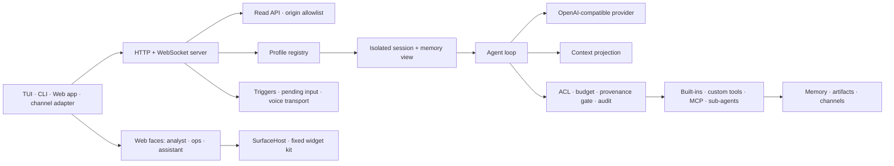
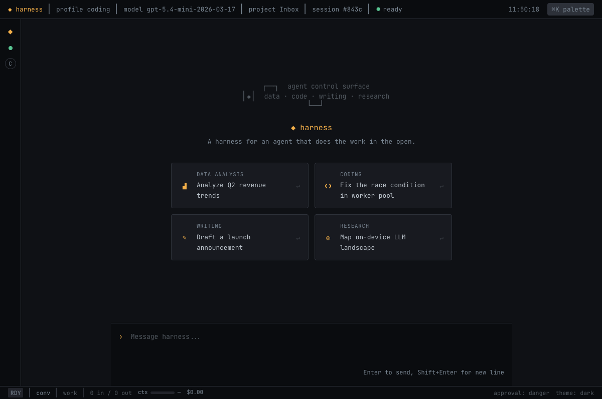
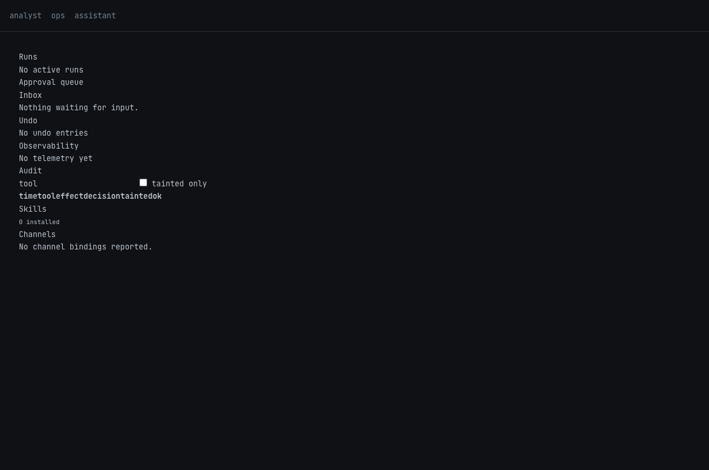
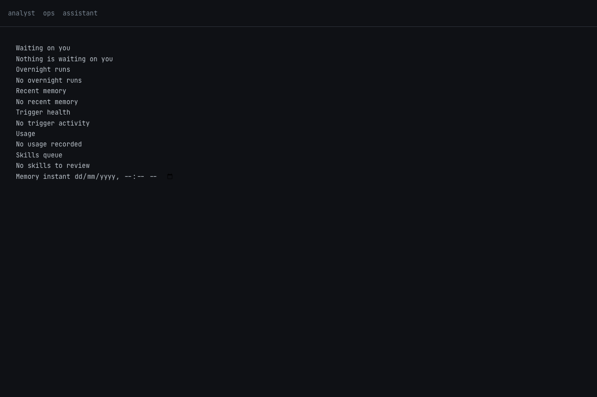

# Architecture

Harness is a profile-driven agent runtime. One process exposes WebSocket and
HTTP entry points, then runs the profile selected for each request. A profile
owns its model, prompt, tools, safety policy, memory, automations, and optional
voice configuration; the runtime stays generic.

The **[interactive architecture explorer](/architecture-site/index.html)**
(source: `docs/architecture-site/` in the repo) is the canonical, detailed
architecture doc — every layer, module, file, and the design choices that
differ from a typical agent harness (conditional ACL, the provenance gate,
durable deferred asks, watch/poll triggers, autonomy budgets, temporal
memory, channels). This page is the shorter operator-facing summary: request
lifecycle, runtime boundaries, and how to actually run and extend the thing.

For a narrative view of the same runtime — what a specific use case actually
does, beat by beat, rather than the full component map — see
**[How it Works](./how-it-works)**. The explorer is the map; the films are
the story. (See ADR-73.)

## System map



## Request lifecycle

1. The server loads one profile or a directory of profiles. A directory is
   registered by profile `name`; an invalid YAML file is logged and skipped.
2. A WebSocket `hello.profile`, REST request `profile`, trigger owner, or channel
   binding selects the profile. Unknown names fail explicitly.
3. Harness creates or resumes a session. Session history is append-only; user
   memory is shared while profile and project memory stay scoped.
4. The loop projects the ledger into a bounded provider request, streams model
   output, executes approved tool calls, and repeats until final output.
5. Effectful calls pass ACL predicates, budgets, provenance gates, hooks, and
   audit logging. Tool output is fed back into the ledger with its provenance.
6. The session, usage, telemetry, artifacts, pending inputs, and audit records
   persist under `~/.harness` or the profile artifact directory.

## Runtime boundaries

| Shared process services | Per-profile state |
|---|---|
| HTTP/WS server, telemetry writer, audit journal, model-client pool, user memory | sessions, profile/project memory, prompt, tool view, ACLs, budgets, trigger owner, MCP client set, channel runtime |

One process is a convenience boundary, not crash isolation. Run separate server
processes when a profile needs a separate failure domain.

## Main features

| Feature | What it gives you | Details |
|---|---|---|
| Self-contained profiles | Prompt and named sub-agent paths resolve beside their YAML. Installed bundles work without a repository checkout. | [Profiles](./profiles) |
| Multi-profile server | One port can serve many agents; a client can choose or switch profiles per connection. | [Profiles](./profiles) |
| Streaming agent loop | OpenAI-compatible provider API, tool-call fan-out, retry, usage and cost tracking. | [Built-in Tools](./builtin-tools) |
| Context projection | Durable append-only transcript, token calibration, pins, digests, and restorable tool output. | [Context Projection](./context) |
| Safety & governance | `allow`/`prompt`/`deny` plus argument-aware `allow_if`/`deny_if`, mode defaults, autonomy budgets, a structural provenance gate against prompt injection, and an audit journal with best-effort undo. | [Safety & Governance](./safety) |
| Extensibility | Profile-defined MCP servers, custom tools, skills, hooks, agents, channels, memory provider, and voice plugins. | [Skills](./skills) · [MCP Servers](./mcp-servers) · [Multi-Agent](./multi-agent) |
| Durable automation | Cron, watch, and poll triggers with a free no-change path; globally capped concurrency; deferred questions that survive a full server restart; pluggable channels to reach a human. | [Automation](./automation) |
| Temporal memory | Facts carry validity intervals and recurrence instead of being implicitly eternal; `Recall` answers "what was true at time T," fully backward compatible. | [Memory](./memory) |
| Voice transport | Binary audio frames, streaming STT/TTS plugin interfaces, sentence chunking, endpointing, voice prompts, and barge-in cancellation. | [Voice](./voice) |
| Product surfaces | Go TUI, readline CLI, REST/SSE API, WebSocket protocol, and browser faces for analyst work, operations, and assistant briefs. Fixed artifacts use the widget kit; generated UI crosses an opaque-origin SurfaceHost boundary (allow-scripts, no allow-same-origin, CSP connect-src none) and returns only allowlisted messages. | [CLI & TUI](./cli-tui) · [Read API](./read-api) |

## Use it

### 1. Install and run the bundled profile family

```bash
curl -fsSL https://raw.githubusercontent.com/pankyada/base/main/scripts/install.sh | sh
export OPENAI_API_KEY='...'
harness-server --profiles ~/.harness/profiles --default-profile coding
```

The installer keeps an existing `~/.harness/profiles/` directory. Each bundled
YAML carries its adjacent Markdown prompt, so no repository-relative prompt
path is required.

### 2. Call a selected profile through REST

```bash
curl http://localhost:7337/run \
  -H 'content-type: application/json' \
  -d '{
    "profile": "coding",
    "user": "pankaj",
    "input": "Explain src/context/projection.ts"
  }'
```

Use `POST /stream` for server-sent token/tool events. `GET /health` reports the
default profile and every loaded profile.

### 3. Select and switch profiles over WebSocket

```json
{ "type": "hello", "user_id": "pankaj", "profile": "coding" }
```

Later on the same connection:

```json
{ "type": "set_profile", "profile": "research" }
```

Each switch starts a fresh session with the selected profile's prompt, model,
memory scope, tools, and channel runtime.

### 4. Define a small guarded agent

```yaml
name: release-notes
model:
  base_url: https://api.openai.com/v1
  api_key_env: OPENAI_API_KEY
  id: gpt-5.4-mini-2026-03-17
system_prompt: ./release-notes.md
working_dir: $CWD
artifact_dir: .harness/release-notes
mode: production
tools:
  builtin:
    Read: allow
    Grep: allow
    Write: prompt
  mcp_servers: []
triggers:
  budget:
    max_cost_usd: 0.25
    max_tools: 20
    max_wall_s: 120
```

`release-notes.md` lives beside the YAML. `$CWD` is deliberate runtime input:
start Harness in the repository you want the agent to inspect.

The browser client is built separately with `pnpm --filter harness-web build`.
Set `NEXT_PUBLIC_HARNESS_WS_URL` and `NEXT_PUBLIC_HARNESS_HTTP_URL` to a
reachable server, and add the browser origin to `HARNESS_ALLOWED_ORIGINS`.

### Web faces

Live empty-state captures from the local build:





### 5. Add streaming voice without adding a vendor to core

Put a provider module under `.agents/voice/`, then reference its provider name:

```yaml
system_prompt: ./assistant.md
system_prompt_voice: ./assistant-voice.md
voice:
  stt: { provider: local-stt, config: {} }
  tts: { provider: local-tts, config: { voice: calm } }
  endpointing: { silence_ms: 700, max_utterance_s: 60 }
  barge_in: true
```

An audio-capable client sends `hello.audio_supported: true`, `audio_start`,
binary frames, and `audio_end`. Harness emits partial transcripts and binary
audio output. Barge-in aborts synthesis and the model turn, then preserves an
interrupted partial in the session ledger.

## Extension locations

| Extension | Location |
|---|---|
| Profile bundle | `~/.harness/profiles/` or an explicit `--profiles` directory |
| Skills | `.agents/skills/<name>/SKILL.md` |
| Custom tools | `.agents/tools/` |
| Channel adapters | `.agents/channels/` |
| Voice providers | `.agents/voice/` |
| Workflow playbooks | `.agents/playbooks/<name>/PLAYBOOK.md` |

See [Profiles](./profiles), [Multi-Agent](./multi-agent), [MCP Servers](./mcp-servers), and [CLI & TUI](./cli-tui) for field-level reference.

## Where to go next

- [Getting Started](./getting-started) — install, run, and a guarded automation example
- [Safety & Governance](./safety) — conditional ACL, the provenance gate, autonomy budgets, audit + undo
- [Automation](./automation) — triggers (cron/watch/poll), durable deferred asks, channels
- [Memory](./memory) — scopes, providers, and temporal facts with `Recall`
- [Voice](./voice) — streaming STT/TTS, endpointing, barge-in
