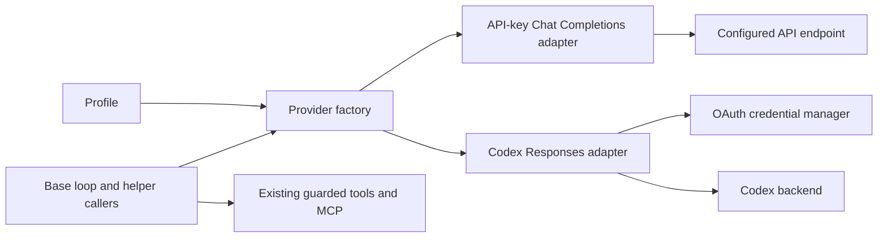

# Codex subscription integration — specification

Date: 2026-09-05
Status: Local experimental implementation validated; live acceptance pending
Scope: Personal, self-hosted Base; OpenAI Codex subscription only
Plan: [Implementation plan](../plans/2026-09-05-codex-subscription-plan.md)

## 1. Outcome and boundaries

Add an explicitly selected Codex OAuth transport alongside existing API-key transport. Base retains its agent loop, tools, MCP execution, approvals, provenance, memory, workflow routing, sessions, and clients. No Codex CLI/App Server subprocess, external agent runtime, or local compatibility proxy.

Existing API-key profiles remain the default and load without edits. Existing Anthropic and other OpenAI-compatible API-key integrations remain supported. No Claude subscription work.

Initial scope: one personal OpenAI account per OS user, browser and device-code login, credentials managed by Node CLI, status in existing CLI/TUI/web surfaces. These are draft scope assumptions; no major layout or style changes are selected. User confirmation remains required before any future major UX redesign.

### Non-goals

- SaaS login, tenants, shared subscription credentials, account pooling, quota evasion, automatic account rotation.
- Automatic API-key fallback, including when subscription expires or quota runs out.
- Reading/importing credentials from Codex, OpenCode, browser cookies, or OS browser sessions.
- New provider-plugin framework, AI SDK migration, replacement of Base's execution engine.
- Codex hosted tools, hosted shell, hosted MCP, web search, image generation, transcription, or TTS through this credential.
- Web-initiated login/logout in v1; no credential mutation through the existing unauthenticated server.
- WebSocket inference optimization in v1; HTTPS/SSE first.
- Claims of unlimited usage, zero upstream charges, or hard provider-side token/dollar ceilings.

## 2. Evidence and interpretation

### Upstream reference, pinned

OpenCode revision: `e2894562f8ba943d72172d10b727c24d5f650c16`, commit time `2026-09-05T03:36:32Z`. Research checked source at this revision, not only moving documentation. This is a `dev` snapshot, not a claim about every released binary.

| ID | Primary source | Observed behavior |
|---|---|---|
| O1 | [Codex plugin](https://github.com/anomalyco/opencode/blob/e2894562f8ba943d72172d10b727c24d5f650c16/packages/opencode/src/plugin/openai/codex.ts) | PKCE/browser + device flows; token refresh; account header; direct Codex endpoint; model filtering; optional WebSocket fetch |
| O2 | [Provider construction](https://github.com/anomalyco/opencode/blob/e2894562f8ba943d72172d10b727c24d5f650c16/packages/opencode/src/provider/provider.ts) | OpenAI provider selects `sdk.responses(modelID)` |
| O3 | [Request preparation](https://github.com/anomalyco/opencode/blob/e2894562f8ba943d72172d10b727c24d5f650c16/packages/opencode/src/session/llm/request.ts) | OAuth system prompt becomes `instructions`; removed from ordinary message prefix |
| O4 | [Provider transforms](https://github.com/anomalyco/opencode/blob/e2894562f8ba943d72172d10b727c24d5f650c16/packages/opencode/src/provider/transform.ts) | Stateless requests, encrypted reasoning inclusion, model-specific options, item-ID cleanup |
| O5 | [Credential store](https://github.com/anomalyco/opencode/blob/e2894562f8ba943d72172d10b727c24d5f650c16/packages/opencode/src/auth/index.ts) | Discriminated API/OAuth credentials; JSON store written with mode `0600` |
| O6 | [License](https://github.com/anomalyco/opencode/blob/e2894562f8ba943d72172d10b727c24d5f650c16/LICENSE) | MIT; preserve notice if substantial code copied/adapted |
| D1 | [OpenAI authentication](https://developers.openai.com/codex/auth/) | Distinguishes subscription sign-in and usage-based API keys |
| D2 | [Responses reasoning guide](https://developers.openai.com/api/docs/guides/reasoning) | Describes reasoning state with tool use and stateless encrypted-content transport |
| D3 | [OpenCode provider docs](https://opencode.ai/docs/providers/#openai) | Advertises ChatGPT subscription and API-key choices |

Important deduction: copying O1's URL rewrite into Base is insufficient. OpenCode already serializes Responses requests through O2/O3/O4. Base currently sends Chat Completions and parses different stream events. Implement real request/response translation.

### What to adopt versus change

Adopt direct OAuth → Codex backend architecture, separate credential type, refresh lifecycle, account routing, stateless Responses requests, and Base-owned tool execution.

Improve for Base: exact destination allowlist; no substring-based arbitrary URL rewriting; loopback-only callback binding; bounded cancellable device polling; cross-process refresh serialization; non-secret account generation checks; explicit model support catalog; truthful cost labeling. Do not copy upstream's zero-price override into Base's dollar-budget calculations.

### Personal-use and compatibility limits

Personal use defines deployment scope; it does not itself establish permission to reuse another application's OAuth client registration. O1 contains public client ID `app_EMoamEEZ73f0CkXaXp7hrann`; public client IDs are not secrets, but source availability is not a grant of service access. OpenCode's advertised support is evidence about OpenCode, not blanket approval for Base. D1 documents Codex authentication, not a stable general-purpose subscription inference API for every harness.

Plan proceeds without assuming a ban or approval. First live compatibility task must record accepted client ID, redirect, truthful Base identification, account entitlement, and relevant provider guidance. If access is rejected, report it; do not spoof OpenCode identity, bypass restrictions, or silently switch billing. Keep direct adapter experimental and opt-in. No implementation or login has been performed for this document.

## 3. Base baseline and change inventory

Base HEAD observed: `13c9ce0fdfe8f414518faba36e4443631dd979d4`. Working tree already contains substantial uncommitted fleet, verifiable-work, web, and documentation work, including several files below. This specification describes the observed checkout, not solely that commit. Reinspect before implementation; preserve unrelated changes.

Read: `CLAUDE.md`, `docs/ROADMAP.md`, relevant ADRs (1, 2, 43, 56, 75–78), current onboarding design, and implementation paths below. ADR-2 needs an explicitly proposed extension; do not silently replace its API compatibility promise.

| Existing path | Required integration |
|---|---|
| `src/provider/client.ts` | Preserve API client pooling; add transport-selecting factory alongside it |
| `src/profiles/schema.ts` | Backward-compatible auth discriminator; Codex settings; validate all configured model roles |
| `src/loop/agent-loop.ts` | Consume normalized provider generation; unchanged guarded tool execution |
| `src/tools/types.ts` | Replace internal `openai` dependency with provider contract; audit extension compatibility |
| `src/context/{projection,digest,estimator,cache}.ts` | Provider-aware digest; correct window; preserve opaque continuation; strip API-specific cache hints on Codex wire |
| `src/safety/classifier.ts` | Same transport; cancellation + existing fail-closed verdict |
| `src/workflow/{runner,triage,knowledge}.ts` | Main/stage/shadow/triage/knowledge requests through common provider path |
| `src/improver/default-improver.ts` | Reflection + skill mining through same provider; explicit background usage attribution |
| `src/server/{index,run-profile,turn-runner}.ts` | Resolve transport for interactive, REST, trigger, resumed, and channel runs |
| `src/agents/runner.ts` | Resolve child's own profile; preserve budget parentage; no credential copying into child data |
| `src/cli/{index,init,doctor}.ts` | Login/status/logout commands; extend existing wizard; transport-correct smoke probe |
| `src/config/{user-config,user-env}.ts` | Preserve default pointer and API env precedence; separate OAuth storage |
| `src/models/registry.ts` | Availability depends on transport, not only base URL |
| `src/session/{types,store}.ts` | Add opaque continuation + usage metadata without rewriting legacy records |
| `src/runs/budget.ts`, `src/usage/ledger.ts`, `src/telemetry/` | Keep estimated-cost controls; add source/basis/completeness metadata |
| `src/types.ts`, generated web protocol, Go protocol | Additive redacted auth/billing metadata; no credentials |
| `web/components/TopBar.tsx`, `tui/internal/ui/statusbar.go` | Existing status locations; no new layout |
| Current replay/evaluation/mission work | Ensure opaque provider state never leaks to exports; playback never invokes live auth or inference |

Current gaps worth testing, not preserving accidentally: several auxiliary model calls bypass central accounting; classifier chooses cheapest same-base-URL model; server constructs client eagerly; API errors may contain raw request details; `doctor` accepts injected environment but provider factory reads global environment. Fix these seams only as needed for this integration, with API regression coverage.

## 4. Normative requirements

| ID | Requirement |
|---|---|
| R01 | Existing API profiles work without migrations; API mode remains default |
| R02 | Explicit `codex_oauth` selection; never infer transport from token presence |
| R03 | No API key required anywhere in a wholly Codex-configured run, including helpers |
| R04 | OAuth credentials remain local to runtime OS account; never WS/REST/session/prompt/telemetry payloads |
| R05 | Browser and device login bounded, cancellable, state-validated; existing credentials survive failed login |
| R06 | Refresh is serialized across Base processes; stale refresh cannot undo logout/relogin |
| R07 | OAuth credential sent only to allowed auth/inference destinations; no redirects carrying secrets |
| R08 | Responses text, function calls/results, usage, errors, refusals, and terminal state translated correctly |
| R09 | Base executes all tools after existing validation/ACL/provenance/approval/hooks/budgets |
| R10 | Complete continuation groups survive tool turns and restart; incompatible state never crosses account/transport |
| R11 | Model roles, context limits, reasoning options and fallback validated per transport |
| R12 | Quota exhaustion/auth failure never switches to API billing automatically |
| R13 | Usage remains measurable; estimated cost not represented as actual subscription charge |
| R14 | Cancellation prevents subsequent helper/model/tool calls and closes network work |
| R15 | Missing Codex login disables affected runs, not unrelated API profiles/server inspection |
| R16 | CLI, REST, TUI, web, workflow, delegation, and unattended paths meet explicit acceptance gates |

## 5. Configuration and selection

Keep current model block; add discriminator inside it. Proposed schema uses a union so Codex does not require an API key or base URL.

```yaml
# Existing profile: unchanged and still default behavior.
model:
  base_url: https://api.openai.com/v1
  api_key_env: OPENAI_API_KEY
  id: gpt-5.4-mini
```

```yaml
# Explicit API mode is also accepted, with identical behavior.
model:
  auth: api_key
  base_url: https://api.openai.com/v1
  api_key_env: OPENAI_API_KEY
  id: gpt-5.4-mini
```

```yaml
# Proposed Codex profile block. Model remains subject to live entitlement.
model:
  auth: codex_oauth
  id: gpt-5.4-mini
  codex:
    reasoning_effort: medium
    max_model_calls_per_run: 64
    request_timeout_ms: 120000
```

Rules:

- Omitted `auth` normalizes to `api_key`. Existing validation and arbitrary OpenAI-compatible `base_url` remain available in that branch.
- Codex branch rejects `base_url` and `api_key_env` rather than silently ignoring contradictory settings. Profile edit preview shows their removal; actual keys in `~/.harness/env` remain untouched.
- Codex issuer/endpoint are implementation constants, not prompt/profile-configurable values. Constructor injection for local test doubles only.
- `fallback_id` remains a model fallback within the selected transport. No auth/backend fallback. Unsupported fallback fails configuration validation before network work.
- `models.roles`, classifier override, digest override (including legacy alias), and improvement override inherit the profile's transport. Explicit incompatible model IDs fail with exact field path. Unspecified helper model uses primary Codex model initially; do not choose cheapest API catalog entry.
- API ambient environment precedence unchanged. In explicit Codex mode, ambient `OPENAI_API_KEY` is irrelevant; it must not hijack mode. Do not delete it from global environment.
- One stored Codex account initially. Multiple profiles share that credential deliberately. Base's session `user_id` is not authentication and must never select a credential file.
- Machine-level `HARNESS_DISABLE_CODEX_OAUTH=1` prevents new Codex network requests; never disables API mode or edits profiles. Report disabled state with API migration instructions.

`max_model_calls_per_run` positive integer, default 64, upper bound 1024. Count actual inference attempts, including retries and helpers, against one root run ledger. Delegated children cannot replenish it. Request timeout positive, bounded to 1–600 seconds, default 120 seconds; tighter caller/run deadline wins. Account-wide per-process inference concurrency default 2; existing global run cap remains authoritative. This is backpressure, not an assertion about provider rate limits.

## 6. Architecture and provider contract



Use existing `openai` dependency for API adapter. Evaluate its installed Responses serializer/parser in the compatibility spike; prefer reuse with a constrained authenticated fetch over a new dependency. Set SDK retries to zero on Codex path if Base owns retries. If SDK makes unsuitable assumptions about Codex SSE, use a small dedicated parser behind the same interface; record fixture evidence explaining choice. Do not monkey-patch `chat.completions.create` to masquerade as Responses.

Proposed files: `src/provider/types.ts`, `factory.ts`, `api-key.ts`, `errors.ts`, `usage.ts`, `src/provider/codex/{adapter,request,stream,models,continuation}.ts`, and `src/provider/auth/{paths,store,manager,oauth,device,lock,redact}.ts`. Names are planned, not existing files.

```ts
type ProviderKind = 'api_key' | 'codex_oauth';
type CallPurpose = 'turn' | 'classifier' | 'digest' | 'triage'
  | 'knowledge' | 'shadow' | 'reflection' | 'skill_mining' | 'doctor';

interface ModelRequest {
  model: string;
  messages: LedgerMessage[]; // Typed supported subset of existing ledger shape.
  tools: FunctionDefinition[];
  purpose: CallPurpose;
  context: ModelCallContext; // root run, session, deadline, usage sink, abort signal.
  options?: ModelOptions;   // Semantic options; serialized by adapter.
}

interface ModelProvider {
  readonly kind: ProviderKind;
  capabilities(model: string): ModelCapabilities;
  stream(request: ModelRequest): AsyncIterable<ModelEvent>;
  complete(request: ModelRequest): Promise<ModelResult>;
}
```

Contract definitions required before coding adapter:

- `LedgerMessage`: system/developer/user/assistant/tool content, optional function calls and opaque continuation reference. Preserve current persisted shape; use boundary guards rather than replacing whole session schema.
- `ModelEvent`: text delta; completed function call (ID/name/JSON arguments); completed generation with usage + continuation; typed failure. No event authorizes execution by itself.
- `ModelResult`: accumulated text/function calls, terminal status, normalized usage, optional opaque continuation. `complete` folds the same generation implementation; no second wire protocol.
- Every helper supplies `ModelCallContext`; no hidden client construction. Detached reflection/mining receives explicit bounded background context and separate usage attribution, not an already-ended user turn or fresh unlimited budget.
- Usage finalization happens once per attempt in shared invocation wrapper. Remove double counting from main loop; account for auxiliary calls. Existing event/session delta semantics remain coherent.
- No business logic in auth manager. No ACL/tool execution in transport. Existing `createProviderClient` remains API-only for compatibility during transition; no production model call site uses it directly at completion.
- Existing custom plugins expecting `ToolContext.openai` require explicit compatibility audit. API-only legacy field may remain deprecated for one release; it must never secretly expose an API client on Codex runs. Built-in callers migrate fully. Document unsupported third-party plugin dependencies rather than claiming full external plugin parity.

### Normalized event and error details

```ts
type ModelEvent =
  | { type: 'text_delta'; text: string }
  | { type: 'function_call'; call: { id: string; name: string; arguments: string } }
  | { type: 'completed'; result: ModelResult };

type ProviderErrorCode =
  | 'auth_required' | 'auth_expired' | 'auth_storage_error'
  | 'auth_access_denied' | 'quota_exhausted' | 'rate_limited'
  | 'model_unavailable' | 'unsupported_input' | 'invalid_request'
  | 'stream_incomplete' | 'transport_error' | 'cancelled' | 'disabled';
```

Failures throw a typed provider error rather than masquerading as successful empty results. `function_call` is emitted only after provider terminal success; loop still buffers all calls until `completed` and its post-response budget/generation checks. `ModelResult` contains `text`, `calls`, `status: completed | refused`, `usage`, and optional continuation. Refused result contains zero calls. A partial-failure error may carry already-visible text and partial usage for interruption/accounting, never executable calls. Event/result duplication is reconciled by adapter IDs, not appended twice by caller.

`ModelCallContext` requires `rootRunId`, `sessionId`, `profileName`, `purpose`, `signal`, absolute deadline, shared attempt ledger, usage sink, and active credential-generation snapshot when OAuth is used. Context may contain an account generation identifier but never a token. Any provider error escaping to clients passes through one redacting formatter. Keep bounded full sanitized provider message, code, HTTP status, request ID, retryability and reset time if provided.

### Session metadata shape

Proposed optional `provider_state` on a persisted assistant generation:

```ts
interface CodexContinuation {
  version: 1;
  provider: 'codex_oauth';
  account_generation: string;
  model: string;
  anchor_call_ids: string[];
  items: OpaqueReasoningItem[];
}
```

`OpaqueReasoningItem` is a validated allowlisted Responses reasoning-item shape, including encrypted content and required summary fields, never arbitrary response objects or headers. `items` preserves original order. Codec derives message/function items from visible ledger so they are not persisted twice. Unknown versions cannot be blindly replayed. Use explicit serializer/deserializer and separate public-message projection; relying on TypeScript types alone does not remove runtime properties from JSON exports.

## 7. OAuth lifecycle and storage

### Browser flow

1. Explicit `harness auth login openai --method browser` creates 32 random bytes for PKCE verifier (base64url) and independent random state. S256 challenge.
2. Bind loopback only, callback port 1455 per observed registration, exact `/auth/callback`. Verify accepted `localhost`/IPv4 redirect combination in spike. No wildcard LAN listener. Occupied port yields actionable error + device command; never stop another process or invent unregistered redirect.
3. Authorization URL on `https://auth.openai.com/oauth/authorize`; observed scopes `openid profile email offline_access`. Source-specific parameters/client ID fixed only after compatibility evidence. Use truthful Base originator/user-agent; no OpenCode impersonation.
4. Match method, host, path, single-valued code/state; reject mismatched/duplicate/replayed callback. Pending authorization remains intact on unrelated malformed request. Do not reflect raw query/error text into HTML or logs.
5. Exchange code at `https://auth.openai.com/oauth/token`, form-encoded, verifier included. Validate success JSON/schema and finite expiry before persisting.
6. Five-minute deadline and SIGINT cancellation; listener closes in `finally` on success, refusal, timeout, or exchange failure. Browser receives success only after exchange/storage succeeds. Existing credential unchanged on failure.

### Device flow

Use observed `/api/accounts/deviceauth/usercode` then `/api/accounts/deviceauth/token`, followed by OAuth code exchange with device callback URI. Print verification URL and user code only to initiating terminal. Honor returned polling interval; upstream adds a three-second safety margin. Respect expiry if supplied; local 15-minute cap otherwise. Handle authorization-pending, refusal, expired code, rate limit, malformed response, and provider-specific pending statuses separately. Do not assume every 403/404 is pending: qualify with captured provider fixture and stop at deadline. Poll network timeout 15 seconds; cancellation interrupts waits and fetches. Noninteractive runs never launch this flow implicitly.

### Credential record

New machine-owned path via `src/provider/auth/paths.ts`: `~/.harness/auth/openai-codex.json`. Separate from `userPaths(...)`, profile YAML, API env file, and `config.json`. Path functions accept injected home directory for tests. Never route from WS `user_id`.

```ts
interface CodexCredentialFile {
  version: 1;
  generation: string; // Changes on login/logout; non-secret concurrency identity.
  revision: number;
  status: 'active' | 'logged_out' | 'reauth_required';
  credential?: {
    access: string;
    refresh: string;
    expires_at: number;
    account_id: string;
    compute_residency?: string;
  };
}
```

Unix parent directory `0700`, file/temp/lock `0600` where applicable; atomic same-directory temp + fsync + rename, cleanup on errors. Refuse symlink/non-regular credential target; no token-bearing backups. Existing generic atomic writer must be audited for permissions and revisions before reuse. Windows mode bits alone are not an ACL guarantee: test current-user-only storage behavior separately; mark Windows support unverified until then. Plaintext at rest documented; keychain implementation deferred.

Do not retain ID token when account data can be extracted at login. Decode provider-issued JWT only as routing metadata, not proof of local authorization. Accept account ID only from validated token-response shape/known claim fields; no fallback to Base session identity. Missing/ambiguous account metadata gives actionable login error. Required routing claims and residency header behavior verified in compatibility spike.

### Refresh, logout and processes

- Refresh with 60-second expiry skew. One in-process promise keyed by credential generation; one cross-process lock for credential mutation/refresh. Lock owner nonce + PID + acquisition time, bounded wait. Live owner is not evicted merely for age. Recover dead-owner lock with verified ownership, otherwise fail closed with repair guidance.
- Inside lock, reread file; another process may already have refreshed. Preserve rotated refresh token, atomically increment revision. Recheck generation before persist. Never recreate credentials after logout/relogin.
- Explicit 401 before any response content: reread/refresh and retry at most once. Invalid grant → `reauth_required`; transient network error preserves credentials. Do not automatically retry an ambiguously completed refresh that could have rotated its token; reread, then require login if no valid new revision exists.
- Logout writes a tombstone with new generation and no credentials; close cached clients. Check generation before each network call and before executing returned tool calls. In-flight bytes cannot be recalled; next boundary rejects them after logout. No claim that local logout revokes remote sessions.
- Re-login with same account replaces generation; account change invalidates all Codex continuation state. Failed login leaves prior valid record intact.
- Queue cancellation removes waiter. One caller canceling must not abort shared refresh for remaining callers; refresh has its own bounded deadline, canceled callers stop before inference.

## 8. Responses wire contract

### Request serialization

Codex POST only to `https://chatgpt.com/backend-api/codex/responses`; bearer access token, `ChatGPT-Account-Id`, JSON content type, SSE accept, truthful Base version user-agent and session identifier. Forward compute-residency only from current validated credential metadata when supported. Auth POSTs only to fixed issuer paths. Disable redirects on credential-bearing fetches. Never allow profile/custom base URL or model response to choose destination.

Minimal body: `model`, `instructions`, `input`, `stream: true`, `store: false`, `tools` when present. Include `reasoning.encrypted_content` when model supports reasoning. Optional `reasoning.effort` validated against model capabilities. No `previous_response_id`, background mode, remote tool execution, or server-owned conversation dependency.

| Base value | Responses representation |
|---|---|
| Trusted system/developer prefix | `instructions`, preserving ordering; no promotion of user/tool content |
| User text | User input message/text content |
| Supported user image content | `input_image` mapping; capability-checked; do not fetch arbitrary image URLs in adapter |
| Assistant visible text | Assistant message/output text |
| Assistant tool call | `function_call`, preserving semantic `call_id`, function name and argument JSON |
| Tool result | `function_call_output` referencing exact `call_id`; denial/error remains content |
| Function schema | Flat Responses function definition, not Chat Completions nested `function` object |
| Base cache hints, timestamps, interruption/taint metadata | Keep locally; never blindly spread onto provider wire |
| Opaque reasoning state | Replayed only through continuation validator below |

Schema handling: preserve semantics; do not blindly force strict mode or rewrite optional properties. Set function strictness only as validated in spike. Unknown content type returns typed unsupported-input error, never silent text loss. Main profile prompt and pinned instructions stay intact; no injected Codex/OpenCode persona.

Codex helper calls also use streaming wire even when caller requests `complete`. Do not forward Chat Completions `max_tokens`, `max_completion_tokens`, `stream_options`, or unsupported sampling fields. Translate semantic JSON requests using supported response-format features only after validation; otherwise retain existing prompt-and-parse logic. Local output/time caps may terminate a request but cannot guarantee upstream billing stops immediately. Validate helper deadlines/quality rather than assuming `temperature: 0` can be reproduced.

### Stream normalization

Use SDK SSE parser if fixtures prove compatible; otherwise incremental UTF-8 parser with CRLF, multi-line data, split JSON frames, comments, event-size limit and bounded buffers. Suggested limits: 1 MiB/event, 1 MiB accumulated function arguments/call, 16 MiB aggregate generation payload; exceed → typed error + abort, not partial execution. Match actual tools/context requirements before raising caps.

- Text deltas → Base token events. Do not append `.done` text again.
- Track function arguments by output-item ID/index and semantic `call_id`; support multiple interleaved calls. Final completion snapshot reconciles items without duplicating deltas.
- Only publish executable calls after successfully completed generation, complete argument assembly and JSON/schema validation. Malformed or truncated stream executes no returned calls.
- Distinguish completed, failed, incomplete, refusal, transport EOF, and user cancellation. EOF without terminal response is failure. Refusal text may display; refusal never becomes tool request.
- Normalize input/output/cached-input/reasoning token counts without double counting cached or reasoning subsets. Missing usage remains unknown/estimated, not confirmed zero.
- Preserve full sanitized provider error message, status/code/request ID and retry-after; redact tokens/headers/query codes. Never print raw SDK request object or full headers.
- Unknown informational events may be ignored explicitly. Unknown executable item or unsupported terminal semantics fail closed.

### Retry ownership

One retry owner in common invocation layer; disable nested SDK/legacy `withRetry` for Codex. Up to two additional inference attempts for explicit pre-output transient rejection (429 with bounded retry-after, retryable 5xx), bounded by run deadline and model-call cap. Quota-exhausted differs from short throttling and does not spin. An ambiguous disconnect/timeout after POST is not assumed unprocessed; stop with resumable error. After any visible delta, never automatically replay generation. No model retry may re-execute recorded tools.

## 9. Continuation, compaction and resume

Codex reasoning continuity is an implementation requirement, not optional polish. Keep Base ledger as source of visible history; add versioned per-generation opaque provider metadata on assistant generation record. Store exact ordered reasoning items needed for continuation, with account generation/model family and anchor call IDs. Do not decode or show encrypted reasoning. Do not synthesize chain-of-thought.

Continuation unit = reasoning items + associated assistant output/function calls + their tool outputs. Serializer replays complete retained units in order. Drop upstream storage-only item IDs when required by stateless serializer, but never alter semantic function `call_id`. Fixture-test this separately; the two IDs are not interchangeable.

- Projection must not split a live call/result/reasoning unit. Compaction removes whole old units after replacing visible content with digest; opaque bytes never enter digest prompt.
- Restart loads metadata with same account context; continuation valid without server-side response storage. Missing/corrupt metadata never causes a tool rerun; either build a safe text-only history after a completed turn or reject incomplete continuation with actionable error.
- Model change validates continuation compatibility. At a completed turn, discard incompatible opaque state and explain reset; while tool cycle pending, reject switch until resolved/canceled. API mode never receives Codex metadata.
- Branch/replay/export/REST message readers filter opaque provider state. It remains available to live serializer and persisted private session only. Historical replay remains deterministic/offline and never refreshes credentials.
- Cancellation records visible partial as interrupted; discard incomplete function calls. Preserve completed historical call results. Existing provenance taint must survive projection/reset unchanged.
- Token estimation includes measured/estimated continuation overhead; compare provider input usage against estimate. Context budget uses Codex capability window, not API catalog's potentially larger window. Never count ciphertext character length as ordinary language tokens without calibration.

## 10. Models, helper calls and execution coverage

Seed a small explicit Codex model capability table from pinned source plus live fixture evidence. O1's known allowlist is evidence for candidates, not entitlement proof. Do not copy its broad future-version regex. Initial primary candidate `gpt-5.4-mini`; promote only after live test. Track ID, supported efforts, input/context/output limits, images, structured-output compatibility, source revision and test date. Unknown models unavailable until validated; no guessed fallback price/window.

All explicit configured helper IDs must be compatible. Missing helper overrides resolve to primary model. Existing API mode resolution remains unchanged. Same-transport fallback only before output and only for recognized model-unavailable errors; not on quota/auth errors, refusal, or partial generation.

Coverage contract:

| Path | Codex behavior |
|---|---|
| Main chat and workflow stages | Stream normalized generation; existing tool guard |
| Safety classifier | Same account, no tools, strict parse; timeout/error remains danger/failsafe |
| Digest and legacy context summarizer setting | Same account; bounded complete; existing fallback projection with warning |
| Triage A/B, shadow completion, knowledge extraction | Same account, usage accounted, existing deterministic fallback/error semantics |
| Reflection / skill mining | Same account; explicit bounded background purpose, usage recorded once; no canceled-turn resurrection |
| REST/SSE, channels, triggers, pending resume | Same profile resolver, no interactive login from background task |
| Delegation/fleet | Child's declared transport; parent call/budget ceiling shared; no injected credential objects |
| Doctor | Transport-specific minimal complete; offline mode performs zero fetch/refresh |

A Codex-only acceptance profile and its children must all be Codex-compatible. Explicit delegation to an existing API profile remains an explicit API dependency, not fallback; UI/status identifies billing mode per child. Do not claim a mixed fleet is subscription-only.

## 11. Accounting, budgets and quota

Preserve existing `cost_usd` meaning as estimated token cost used by Base, including budget checks and child allocations. For Codex, calculate conservative API-equivalent estimate from known reference prices; label `cost_basis: api_equivalent`, `billing_mode: subscription`, `billed_cost_usd: null`. For API calls label existing estimator `cost_basis: api_estimate`, `billing_mode: api`; it is not a provider invoice either. Do not zero prices merely because authentication is subscription-based.

Add metadata to per-attempt usage and aggregated session/run/ledger summaries: API-estimate subtotal, Codex-equivalent subtotal, input/output/cached/reasoning counts, complete/partial/estimated usage status. Mixed totals explicitly labeled mixed estimates. Legacy missing metadata is `legacy_estimate`, not retroactively verified billing.

Existing `max_cost_usd` continues to constrain estimated work, also for Codex; display “estimated API-equivalent budget” for that portion. Maintain tool and wall-time ceilings; add shared model-attempt cap. Before every helper/main attempt check budget/deadline; finalize usage once after response. If final usage missing, reserve a conservative bounded estimate and record uncertainty; never return unused reservation as confirmed zero. Unknown reference pricing prevents bounded autonomous Codex run until configured/validated. Existing budgets are checkpoints, not hard upstream maximum spend; document overshoot and cancellation latency.

Concrete accounting rule: successful usage uses reported input/output totals times validated reference prices; cached input and reasoning output remain subsets and are not added again. Initial Codex estimate does not discount cache, making budget estimate conservative. For accepted or ambiguously accepted requests with no final usage, retain estimated input plus model's validated output ceiling as `usage_status: estimated`; this may exhaust local budget and must explain why. An explicit pre-generation rejection records a model attempt but no generated-token estimate. Never infer billing from that local estimate. Do not reserve the full model output ceiling before every successful call, which would reject ordinary small budgets unnecessarily; reserve uncertainty when final usage is unavailable and stop further work as required.

Use response error/reset metadata only when recognized. Quota display may be “unknown”; absence is not 100% remaining. No separate undocumented quota polling endpoint in v1. Provider-level cooldown shares across profiles in process. Cross-process inference rate synchronization is out of scope; credential refresh locking is not.

## 12. CLI and existing client behavior

Proposed commands (not implemented):

```text
harness auth login openai --method browser
harness auth login openai --method device
harness auth status openai --json
harness auth logout openai
harness init --reconfigure --profile coding
harness doctor --offline --json
```

Login stores credentials only; never silently modifies profile/default model. Logout clears Codex credential only; API keys untouched. Status is local/read-only, no implicit refresh, displays active/expired/missing/reauth-required/disabled, masked account hint, transport, expiry and next command. Exit codes: 0 ready/success; 1 operational failure; 2 invalid arguments; 3 login required/expired/disabled; 130 interrupted. Offline status must distinguish “credential present” from live provider acceptance.

`harness init`: reuse current profile picker and provider flow, add OpenAI auth-method choice, API key initially selected. Existing Codex profile retains its explicit choice on reconfiguration. Preview profile changes, preserve backup/diff confirmation behavior. No second profile selector or default-profile representation. `--yes` never opens browser/device authorization or overwrites mode unexpectedly; missing selected credentials produce actionable exit. Go setup continues to delegate to Node CLI per ADR-77.

Server constructs transport lazily. Missing credential can appear in redacted session/provider status; starting affected generation fails cleanly while API profiles and inspection remain available. Newly logged-in credential recognized next run without full server restart. Auth/transport change mid-generation requires cancel + next run; cannot switch billing midstream.

Add optional redacted provider status to existing `session_ready`/stats/model metadata, with run/agent attribution where relevant. Use notices for expiry/quota/errors and existing status components for mode/estimate labels. Generate web protocol from `src/types.ts`; update Go structs and older-client defaults. No token/refresh/device code fields in shared protocol, REST or model lists. Major UX changes need separate confirmation; this spec chooses only behavior and existing locations.

## 13. Acceptance matrix

| Gate | Required evidence |
|---|---|
| A01 / R01–02 | Legacy profile fixtures unchanged; ambient API env wins; OAuth never selected by mere token presence |
| A02 / R05 | Browser success/refusal/state mismatch/duplicate callback/timeout/occupied port; device pending/expiry/cancel; no external callback bind |
| A03 / R04,06 | Two-process refresh race; rotated token persisted; logout-during-refresh cannot resurrect; malformed store never overwritten |
| A04 / R07 | Mock adversarial destinations and redirects receive no OAuth header; no secrets in logs/WS/REST/files beyond credential store |
| A05 / R08–09 | Split/interleaved SSE, multiple tool calls, denial result, invalid JSON, incomplete/EOF/refusal; zero execution before valid terminal completion |
| A06 / R10 | Two tool cycles, encrypted state, saved-session restart, compaction, API/model/account switch, cancellation; no orphan calls or repeated effects |
| A07 / R03,11 | Remove all API keys from isolated test environment; main/helpers/workflows/delegated Codex profiles complete; incompatible override fails early |
| A08 / R12–14 | Quota stop, bounded throttle retry, 401 refresh once, partial-stream failure no replay, cancel during helper/refresh/queue |
| A09 / R13 | Main + helper + child accounting once; missing usage unknown; estimate budget/model-call/tool/wall ceilings hold |
| A10 / R15–16 | Missing login leaves API profiles usable; login noticed without restart; CLI/TUI/web/REST statuses agree |
| A11 | Existing safety/provenance/deferred-ask/parallel-tool regression suites pass; replay remains offline |
| A12 | Real personal-account browser + device login, text/tool/multi-turn/restart smoke; redacted evidence records model/account hint/provider request IDs |

Mock contract tests are mandatory but do not establish account entitlement, model quality, actual subscription billing, or Windows behavior. A12 requires inspecting account usage/billing source where available; header routing alone is not proof. Record uncertainty if upstream usage display cannot attribute small requests.

## 14. Rollout and decision register

Implement as additive opt-in. Keep shipped profiles on API mode; provide documented Codex model-block example, not automatic profile migration. First acceptance on macOS; Linux device flow/container home ownership next. Windows personal runtime acceptance explicit, not inferred from compilation.

Before code, propose new ADR(s) extending ADR-2: transport-neutral model interface with preserved API path; direct Codex personal-use adapter; OAuth storage lifecycle; estimated-cost semantics. Assign next free ADR number at implementation time because `docs/ADR.md` is already dirty. This task does not mark any decision implemented or edit roadmap status.

Rollback: disable Codex adapter; explicitly restore profile API model block from preview/backup, retaining key env file; log out locally if desired. Preserve session history; exclude opaque Codex state when reading through API adapter. No auth migration rewrites other applications' files. Backward binary rollback only after testing old reader tolerance for new metadata; keep original session backups outside exported artifacts if migration ever becomes necessary.

## 15. Remaining live questions, not assumptions disguised as facts

1. Does observed client registration accept Base's truthful identity and callback/device flow for this account? What provider guidance applies to reuse? No affirmative permission claim made here.
2. Which candidate models/options/limits are currently available on this personal subscription? Validate a small table; do not assume all API models work.
3. Does installed OpenAI SDK parse exact Codex responses without extra transport changes? Validate SSE, error and continuation fixtures before selecting parser.
4. What happens to usage attribution and refresh rotation under real timeout? Do not induce quota exhaustion or discard working credentials merely to test; use controlled fixtures plus small live probes.

None prevents writing/reviewing this spec. They are explicit Sprint 0/acceptance checks before claiming integration complete.
