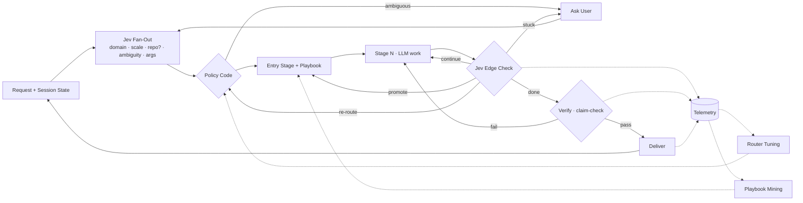

# Request routing graph specification

**Task:** PT-075 (specification); implementation phases PT-076–PT-081
**Roadmap:** #31
**Date:** 2026-09-23
**Status:** approved design; phase 1 (PT-076) authorized
**Primary feature:** CORE-06; also CORE-05, CORE-07, CORE-11
**Affected clients:** Core runtime and profile authors. Phases 1–2 and 4–6 need no client protocol change. Phase 3 reuses the existing `input_request` frame for clarification; no new WS message type or protocol version. TUI/Web stage strips keep working because `onStage` events are unchanged.

## 1. Goal

Route every workflow request through a typed judgment graph built on the existing workflow runner:



**Jev judges the edges; LLMs do the work at the nodes; policy is plain code.** Jev never generates stage output and is never an authority for tool execution, approvals, ACL, provenance, or budget admission (Jev decision-layer spec §1 still applies).

### Non-goals

- A new graph/DAG engine. `runWorkflow` in `src/workflow/runner.ts` is already the state machine (stage pointer, fail-back, tier promotion); this extends it.
- Dynamically invented playbooks at runtime. Playbook mining (phase 6) only *proposes* playbooks for human review, like skill mining.
- Parallel multi-playbook DAGs. Multi-domain requests run sequentially (§5.3).
- Changing behavior of profiles without `workflow.enabled`. The flat loop stays untouched.

## 2. Invariants (every phase must keep these)

1. **Recon gate.** Recon always runs with intensity ≥ 1. No scale, entry-stage, or re-route decision may set recon to 0 or skip it. Re-route restarts at the new playbook's recon only if the prior recon artifact is not reusable (§5.4); otherwise it passes the recon artifact forward.
2. **Default parity.** With the new decision features absent, `disabled`, or `shadow`, runtime behavior (stage sequence, intensities, tiers, prompts, tool schemas, wire frames, memory writes) is identical to today. Shadow only adds bounded telemetry events with no raw request text, prompts, tool payloads, or model output.
3. **Jev failure falls back.** Any Jev `unavailable`/network/validation failure falls back to today's path (profile playbook, `triageA`, regex escalation). `WorkflowDecisionControlError` (control outcome) still propagates as today.
4. **Bounded loops.** Re-routes ≤ `workflow.router.max_reroutes` (default 1); clarifications ≤ `workflow.router.max_clarifications` (default 1) per task; existing `max_stage_retries`, `max_usd_per_task`, and deadline still bound everything.
5. **Profile-generic.** Nothing coding-specific in router code; domains are playbook names discovered from disk and filtered by profile config.
6. **Only configured playbooks.** Router may select only playbooks in `workflow.router.candidates` (or, when omitted, only `workflow.playbook`, i.e. routing is a no-op).

## 3. Configuration

Two additive schema changes.

`decision_layer.features` (in `src/decisions/types.ts`, `.strict()` object) gains:

```yaml
decision_layer:
  features:
    request_routing: shadow     # fan-out + policy (phases 2–3)
    edge_checks: shadow         # per-stage Jev edge judgment (phase 4)
    claim_check: shadow         # verify claim-check (phase 5)
```

Each uses the existing `DecisionFeatureModeSchema` (`disabled | shadow | enforce`) and the existing `allow_remote_state` guard.

`workflow` (in `src/profiles/schema.ts` `WorkflowSchema`) gains an optional `router` block:

```yaml
workflow:
  enabled: true
  playbook: generic            # fallback/primary when router is off or unsure
  router:
    candidates: [coding, data, writing, research, generic]
    domain_threshold: 0.5      # Noul p above which a playbook is "in"
    ask_threshold: 0.7         # ambiguity Noul p above which we clarify (0.6 over-asked in live eval)
    max_reroutes: 1
    max_clarifications: 1
    scale_presets:             # optional; per-scale intensity floors, recon clamped ≥1
      trivial: { plan: 0, design: 0, verify: 1, review: 0 }
      small:   { plan: 1, design: 0, verify: 1, review: 0 }
      medium:  { plan: 2, design: 1, verify: 2, review: 1 }
      large:   { plan: 3, design: 2, verify: 2, review: 2 }
```

Absent `router` ⇒ router disabled regardless of feature modes. Presets merge *under* existing `min_intensity`/`max_intensity` clamps (`clampIntensity`).

## 4. Components

| Diagram node | Module | Phase |
|---|---|---|
| Playbook threading, `listPlaybooks()` | `src/workflow/playbook.ts`, `runner.ts` | 1 |
| Jev Fan-Out `chooseRoute()` | `src/decisions/workflow.ts` | 2 |
| Policy `decideRoute()` | new `src/workflow/route.ts` (pure) | 2 |
| Ask User / session route memory / multi-domain | `runner.ts`, `src/session/types.ts` | 3 |
| Edge check `judgeEdge()` + re-route | `src/decisions/workflow.ts`, `runner.ts`, `route.ts` | 4 |
| Verify claim-check `checkClaims()` | `src/decisions/workflow.ts`, `runner.ts` | 5 |
| Telemetry analysis, tuning, playbook mining | `src/analysis/routing.ts`, `src/workflow/adaptive.ts`, `src/improver/` | 6 |

## 5. Behavior

### 5.1 Fan-out (`chooseRoute`)

One `provider.evaluate` call, all questions independent (parallel on Jev side). State: bounded request (≤ 8 000 chars), candidate playbooks with `name` + `description`, the session's last route (§5.5) if any, and bounded last assistant message (≤ 2 000 chars) for follow-ups.

Questions:
- `domain_<playbook>` — **Noul** per candidate: "This request needs the <name> workflow (<description>)." Multi-label by design.
- `scale` — **Score** with levels `trivial | small | medium | large`, each described concretely (e.g. trivial: one-line answer or single small edit; large: new multi-component system or multi-day effort).
- `has_existing_work` — **Noul**: request operates on existing files/data/project rather than from scratch.
- `ambiguous` — **Noul**: a competent assistant could not start without asking one clarifying question.
- `continues_previous` — **Noul** (only when a session route exists): request is a follow-up to the previous task.

Returns `RouteSignals` (probabilities, not decisions). Branch-specific argument slots are deferred until a playbook declares them (future `router_args` frontmatter); not in scope for v1.

### 5.2 Policy (`decideRoute`)

Pure, synchronous, fully unit-tested. Input: `RouteSignals`, router config, current playbook, session route. Output:

```ts
type RouteDecision =
  | { kind: 'ask'; reason: 'ambiguous' }
  | { kind: 'run'; playbooks: string[]; primary: string; scale: Scale; intensityFloor: Partial<IntensityMap>; why: string }
```

Rules, in order:
1. `ambiguous > ask_threshold` and clarifications remaining ⇒ `ask`.
2. `continues_previous > 0.5` and session route exists ⇒ reuse session route's primary playbook.
3. Playbooks with `domain > domain_threshold`, sorted by p desc. None ⇒ `[workflow.playbook]`.
4. `scale` = argmax level; `intensityFloor` = `scale_presets[scale]` with recon forced ≥ 1.
5. On a near-tie between scale levels (top two within 0.15), choose the **larger** (misroute cost is asymmetric: under-planning costs more than over-planning).

### 5.3 Multi-domain

v1: run `primary` fully, then each additional playbook in order as a fresh `runWorkflow` pass whose `prior` artifacts include the preceding pass's final artifact. Cap at 2 playbooks per request. Each pass has its own `task_id`, linked by `parent_task_id` in telemetry.

### 5.4 Edge check (`judgeEdge`)

Runs after each non-recon stage **only when** code-level `shouldEscalate` did not already fire on hard signals (`contract_ok === false`, `tool_error_rate`, `edit_rewrites`, budget). Hard signals stay authoritative in code.

State: stage name, bounded stage artifact (≤ 6 000 chars), bounded request, playbook name, remaining stages. Questions:
- `next` — **Choice**: `continue | promote | reroute | stuck | done`, each with a concrete definition. `promote` = work is bigger than planned; `done` = request already fully satisfied.
- `drift_<playbook>` — **Noul** per other candidate (only when router active): remaining work now belongs to that playbook.
- `failed_back` — **Choice** over earlier stages plus `none`: which earlier stage's output was wrong. Replaces the regex in `failBackTarget` in enforce mode.

Mapping in enforce mode:
- `continue` ⇒ `pointer++` (today).
- `promote` ⇒ raise the remaining stages' intensity floor one scale level and set pointer to `plan` (never before recon).
- `reroute` (with max drift > `domain_threshold` and reroutes remaining) ⇒ switch playbook, keep recon artifact, restart at new playbook's `plan`.
- `stuck` ⇒ clarification via §5.6 if remaining, else existing abandon path.
- `done` ⇒ skip to verify (if verify intensity > 0) else finish.

Shadow mode: compute and log `{regex_verdict, jev_verdict, agree}`; take regex path.

### 5.5 Session route memory

`Session.workflow_route?: { playbook: string; scale: Scale; task_id: string; at: string }`, optional and additive (legacy sessions omit it). Written on Deliver; read by fan-out as state. Persisted by the existing session store.

### 5.6 Ask user

Uses the existing agent input request mechanism (roadmap #9; `input_request` frame, and the deferred-ask path for unattended runs). The prompt is a single clarifying question; the question text is produced by the `cheap` role model from the request (Jev does not generate text). The answer is appended to the request as `Clarification: <answer>` and fan-out re-runs. Unattended runs with no human channel skip asking and proceed with the policy result minus rule 1.

### 5.7 Verify claim-check (`checkClaims`)

*(Amended 2026-09-23, PT-080: the "non-coding" condition was dropped as it violated invariant 5; the check runs once when a pass completes — i.e. after verify passed, or before acceptance when verify did not run — on the final delivered artifact, which is the review artifact when review runs.)* At pass completion, code extracts up to 8 candidate claims (sentences containing numbers, named files, or "passes/fails/is/are" assertions) from the final artifact, pairs each with evidence from session tool results (bounded, tainted-aware, reusing `DecisionAdvisoryService` taint handling). One Noul per claim: "The evidence supports this claim." Any claim with p < 0.3 ⇒ fail ⇒ pointer to `build` (counted as a re-entry). Shadow logs only.

### 5.8 Telemetry

New `logEvent` kinds, no raw text:
- `route`: `task_id`, `mode`, candidates, domain probabilities, scale distribution, ambiguous p, decision kind, chosen playbooks, fallback reason.
- `edge`: `task_id`, stage, regex verdict, Jev verdict, agree, applied action.
- `claim_check`: `task_id`, claim count, min p, verdict.
- `reroute` / `clarify`: task linkage and reason.

## 6. Phases and acceptance

Each phase ships independently, is TDD, and must pass `pnpm typecheck` and full `pnpm test`.

### Phase 1 — PT-076 · groundwork (no behavior change)
- `listPlaybooks(): Playbook[]` in `playbook.ts` over `resolvePlaybookDirs()` (+ builtin `generic`), de-duplicated with most-specific-wins like `loadPlaybook`.
- `executeStage` takes the resolved `Playbook` as a parameter instead of calling `loadPlaybook(profile.workflow?.playbook …)`; `runWorkflow` and the plan-preview path pass their loaded playbook. Telemetry `playbook` fields use the passed playbook's name.
- Schema: `workflow.router` block (§3) and the three `decision_layer.features` keys, all optional, default absent/disabled.
- `Session.workflow_route?` type added (not yet written).
- **Accept:** existing workflow tests pass unchanged; new tests cover `listPlaybooks` discovery/dedupe, schema defaults/validation (incl. `allow_remote_state` guard covering new features), and that `executeStage` uses the passed playbook (e.g. a stage contract from a non-profile playbook).

### Phase 2 — PT-077 · fan-out + policy, shadow only
- `chooseRoute` on `WorkflowDecisionAdvisor`; `decideRoute` in `route.ts`.
- In `runWorkflow`, when router configured and `request_routing` is `shadow` or `enforce`: call fan-out, compute decision, log `route` event. **Shadow and enforce both still run today's path in this phase.**
- Labeled routing cases (≥ 30, spanning every candidate playbook, scales, ambiguous, multi-domain) added to `tests/fixtures/decision-evaluation.json` and scored by `scripts/evaluate-decisions.ts` offline.
- **Accept:** `decideRoute` table tests cover every rule in §5.2 incl. recon ≥ 1 and tie→larger; mock-provider tests show shadow emits `route` events and does not change stage sequence; Jev failure falls back silently.

### Phase 3 — PT-078 · enforce route, ask-user, session route, multi-domain
- Enforce mode applies `RouteDecision`: selected playbook replaces profile playbook for the task; intensity floor merged; `ask` path per §5.6; session route written on Deliver; sequential multi-domain per §5.3.
- **Accept:** fake-provider runtime tests for each branch; follow-up reuse; ask count bounded; unattended skip; recon gate invariant test.

### Phase 4 — PT-079 · edge checks + re-route
- `judgeEdge`; shadow comparison logging; enforce mapping per §5.4; re-route with cap.
- **Accept:** tests for each `next` outcome, hard-signal precedence, re-route cap, recon never skipped, agree/disagree telemetry.

### Phase 5 — PT-080 · verify claim-check
- Claim extraction + `checkClaims`; fail → build; taint-aware evidence.
- **Accept:** tests for supported/unsupported claims, cap of 8, re-entry counted, shadow no-op.

### Phase 6 — PT-081 · learning loop
- `harness stats routing` gains route confusion (chosen vs later re-routed), re-route rate, clarify rate, edge agreement rate, claim-check fail rate.
- `adaptive.ts` routing-policy doc may carry tuned `domain_threshold`/`ask_threshold` per playbook (read only when present).
- Improver proposes a new playbook when ≥ N (config, default 10) low-confidence `generic` routes cluster; proposal lands in the existing proposed-skill review flow style, never auto-installed.
- **Accept:** fixture-driven stats tests; threshold override read path; mining proposal test.

## 7. Live acceptance (separate from automated)

Automated tests use mock/fake providers and prove wiring only. Live Jev routing quality is established only by running `scripts/evaluate-decisions.ts` against the real provider and by a shadow-mode period on a real profile, recorded as evidence in `docs/PRODUCT_STATE.md`. Enforce mode should not be recommended in docs until that evidence exists.
